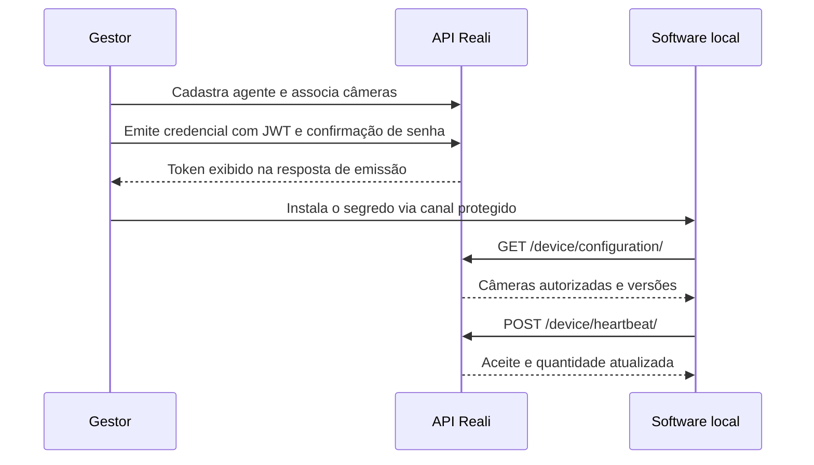

# Agentes locais

`EdgeDevice` identifica um computador ou serviço local e tem uma única escola. O `id` é usado no gerenciamento do recurso. `device_identifier` é um UUID público estável para inventário e suporte. `agent_version` e `last_seen_at` vêm de heartbeats aceitos pelo servidor.

1. Com JWT de gestor e o contexto da organização, cadastre o dispositivo e selecione a escola.
2. Cadastre a portaria e a cantina com `edge_device` ou associe câmeras existentes com PATCH. Consulte a nota de transição caso elas estejam publicando contagens pelo contrato legado.
3. Salve as configurações de cada câmera e emita uma credencial do agente, confirmando a senha administrativa.
4. Instale a credencial e a URL base HTTPS em configuração protegida ou gestor de segredos do serviço existente. O agente obtém as câmeras habilitadas em `GET /device/configuration/` e publica telemetria no heartbeat.

`PATCH /edge-devices/{id}/` permite editar o nome e a habilitação. O agente mantém a escola original. Desativá-lo bloqueia a autenticação. Após reativação, uma credencial ainda ativa e não expirada volta a ser aceita. Para encerrar o acesso também após reativação, revogue a credencial.

## Transição das instalações legadas

Câmeras sem agente preservam o heartbeat vazio e o envio de contagens por `X-Camera-ID` e `X-Camera-Key` enquanto `CAMERA_LEGACY_AUTH_ENABLED=true`. O primeiro vínculo com um agente revoga a chave antiga da câmera. Coordene a associação de câmeras que já publicam contagens com a troca para o token e payload da Fase 4. A [API de contagens](DEVICE_COUNT_API.md) permite reenviar IDs confirmados pelo contrato legado usando a nova credencial.

Consulte a [autenticação](DEVICE_AUTHENTICATION.md) e o [contrato de heartbeat](CAMERA_HEARTBEAT.md).
