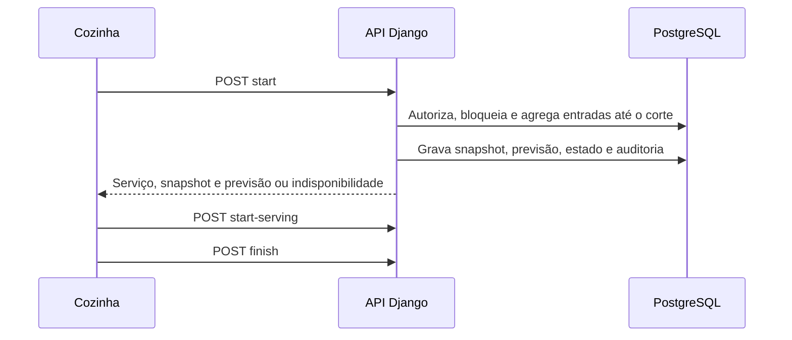

# Serviços de merenda

`MealService` representa a execução de uma refeição em uma escola e data. A API mantém `date`, `scheduled_time` e `meal_type`. Os campos `scheduled_end_time`, `entry_window_start` e o vínculo opcional de programação complementam o horário. A combinação escola, data, tipo e início distingue turnos. Horários previstos usam o fuso Django. As transições registram horário do servidor e funcionário responsável.

| De | Para | Condição |
|---|---|---|
| `PLANNED` | `PREPARING` | Escola e vínculo ativos, papel autorizado e data do serviço atingida. Snapshot, previsão, estado e auditoria são gravados juntos. |
| `PREPARING` | `SERVING` | Registra início real e responsável pela distribuição. |
| `SERVING` | `FINISHED` | Registra fim real, responsável e qualidade operacional da cantina. |
| `PLANNED` ou `PREPARING` | `CANCELLED` | O gestor informa justificativa. A operação exige ausência de contagens e ajustes de pratos. |

Repetir `start` enquanto o serviço está em preparo devolve o snapshot e a previsão originais. Transições repetidas fora desse estado devolvem `409`. Serviços finalizados ou cancelados continuam disponíveis nos filtros históricos. Somente serviços planejados aceitam edição. O cancelamento conserva qualquer previsão já registrada. A reconstrução vigente de indicadores exclui previsões de serviços cancelados.

A API de contagem da Fase 4 continua usando a janela real de distribuição. Um prato tardio de serviço finalizado é aceito quando ocorreu dentro da janela real e chega dentro do limite de atraso, com o serviço correto. Os eventos posteriores preservam a previsão inicial.

Veja [programação](MEAL_SCHEDULES.md), [snapshots](ATTENDANCE_SNAPSHOTS.md) e o [contrato HTTP](FORECAST_API.md).
