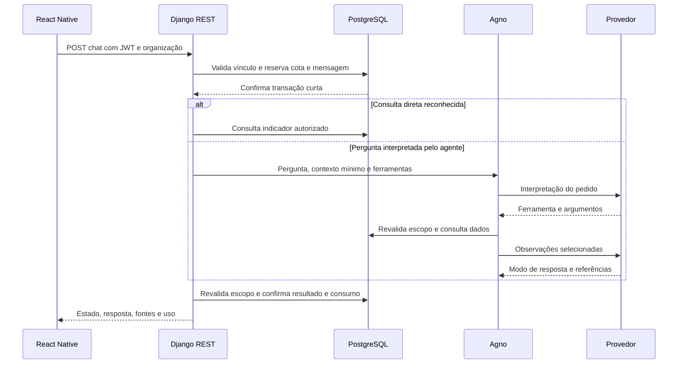

# Arquitetura do RealInova

A Fase 7 usa o app `apps.ai` no Django. A pesquisa no projeto encontrou permissões previstas para o RealInova e a camada de consultas da Fase 6. O diretório raiz `realinova` estava vazio. A fase acrescenta o histórico e a execução do agente no backend existente.

| Componente | Responsabilidade |
| --- | --- |
| Django REST Framework | Autentica a sessão JWT existente, valida corpo e contexto e expõe conversas, mensagens, chat e utilização. |
| `authorization.py` | Deriva o conjunto autorizado de escolas usando os vínculos da Fase 2 e revalida o escopo durante a execução. |
| `services.py` | Reserva uso e custo, controla idempotência, persiste histórico e finaliza a execução em transações curtas. |
| `provider.py` | Instancia um Agno Agent por turno, configura o modelo, acompanha chamadas, tokens e falhas e aplica fallback quando autorizado. |
| `tools.py` | Consulta projeções e fatos por seletores da Fase 6. |
| `agent.py` | Define as instruções, interpreta a seleção do modelo e monta as respostas com os valores e fontes produzidos pelo Django. |

A chamada de rede ocorre fora das transações de reserva e finalização. Django mantém a única cópia do histórico das conversas. Operações analíticas leem os dados originais ou suas projeções segundo as regras da Fase 6. Consulte [os fluxos e retornos HTTP](REALINOVA_API.md) e [a camada analítica](ANALYTICS_ARCHITECTURE.md).
